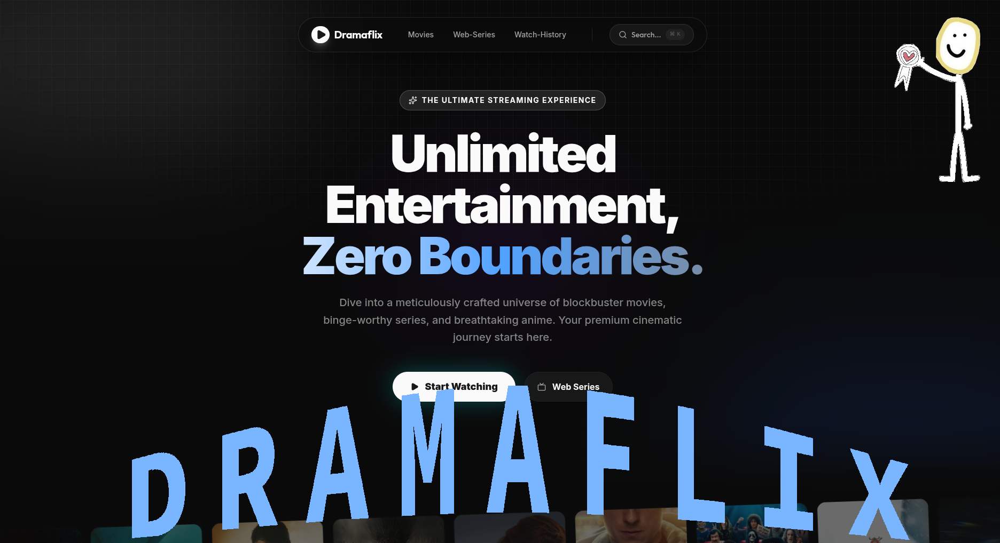

# Dramaflix

Modern Next.js app for browsing movie and TV metadata with external playback embeds. This repository is a frontend application only. It does not host or store any media files.




## What This App Does

- Fetches **metadata** (titles, overviews, cast, images, ratings) from TMDB
- Renders **external embeds** for playback inside iframes
- Stores watch history and playback progress **only in the browser** (localStorage)

## Data Sources & External Services (Full Transparency)

### Metadata & Images

- **TMDB API** (metadata): `https://api.themoviedb.org/3/`
- **TMDB Image CDN**: `https://image.tmdb.org/t/p/`

### Playback Embeds (used directly in UI)

These are hard-coded iframe sources used in the current UI (selectable via a dropdown on each player):

**Movies** (`src/components/movies-ui/movie-players.tsx`):

- `https://embedmaster.link/<redacted>/movie/{id}`
- `https://vidsrc.buzz/embed/movie/{id}`
- `https://vidfast.vc/movie/{id}`
- `https://player.videasy.ws/embed/movie/{id}`
- `https://www.2embed.stream/embed/movie/{id}`
- `https://vixsrc.to/movie/{id}`
- `https://cinesrc.st/embed/movie/{id}`
- Download link: `https://vidvault.ru/movie/{id}`

**Series** (`src/app/web-series/watch/[...slugs]/page.tsx`):

- `https://embedmaster.link/<redacted>/tv/{seriesId}/{season}/{episode}`
- `https://vidsrc.buzz/embed/tv/{seriesId}/{season}/{episode}`
- `https://vidfast.vc/tv/{seriesId}/{season}/{episode}`
- `https://player.videasy.ws/embed/tv/{seriesId}/{season}/{episode}`
- `https://www.2embed.stream/embed/tv/{seriesId}/{season}/{episode}`
- `https://player.embed-api.stream/?id={seriesId}&s={season}&e={episode}`
- `https://vixsrc.to/tv/{seriesId}/{season}/{episode}`
- Download link: `https://vidvault.to/tv/{seriesId}/{season}/{episode}`

Both players share `src/components/embed-source-player.tsx`.

### Proxy note

When `NEXT_PUBLIC_PROXY` / `NEXT_PUBLIC_PROXY_2` are unset, image URLs point directly at `image.tmdb.org`. When set, they are prefixed with the proxy origin.

### Proxies (optional)

The app can route image and HLS requests through proxies you control:

- `NEXT_PUBLIC_PROXY` (images)
- `NEXT_PUBLIC_PROXY_2` (images)
- `NEXT_PUBLIC_M3U8_PROXY` (HLS video)

### Browser Storage Only

- Watch history and playback progress are stored in **localStorage** only.
- No database is used.

**Source file:** `src/utils/localStorage.ts`

## Remote Image Allowlist

Next.js image remote patterns are configured in `next.config.mjs`. The allowlist includes:

```
image.tmdb.org
s4.anilist.co
media.kitsu.io
artworks.thetvdb.com
asianimg.pro
img.freepik.com
i.pinimg.com
cdn.myanimelist.net
sup-proxy.zephex0-f6c.workers.dev
gogocdn.net
m3u8proxy.zephex0-f6c.workers.dev
m3u8proxy.goodproxy.workers.dev
goodproxy.goodproxy.workers.dev
goodproxy.dramaflix.workers.dev
m3u8proxy.dramaflix.workers.dev
cdn.noitatnemucod.net
i.ytimg.com
```

## No Hosting / No Storage of Media

This repository contains **source code only**. It does not include or store video files. Playback, if used, is rendered from third‑party embeds.

## Environment Variables

Create `.env.local` in the project root:

```env
# Required for TMDB metadata
TMDB_API_KEY=your_tmdb_api_key_1,your_tmdb_api_key_2

# Optional image proxies
NEXT_PUBLIC_PROXY=https://your-image-proxy.example
NEXT_PUBLIC_PROXY_2=https://your-image-proxy.example
```

## Scripts

```bash
npm run dev
npm run build
npm run start
npm run lint
```

## Deployment

This is a standard Next.js app. Deploy it to any Node.js host (Vercel, Netlify, Render, etc.).

**Build command:** `npm run build`  
**Start command:** `npm run start`

## Legal & Usage Notes

- This app displays **metadata** from TMDB and renders **third‑party embeds** for playback.
- It does **not** host, upload, or store media files.
- You are responsible for ensuring any content you access through third‑party services is authorized in your jurisdiction and complies with those services’ terms.

## Project Structure (High Level)

```
src/
  app/                     # Next.js routes
  components/              # UI components
  utils/                   # API helpers, types, localStorage
```

## License

MIT (code only). See `LICENSE`.
